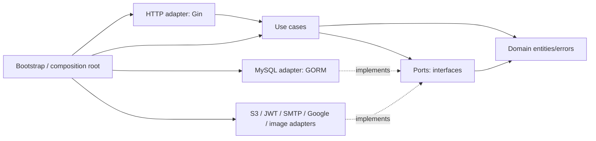

# Clean Architecture

Dependency direction:



| Layer | หน้าที่ | ห้ามขึ้นกับ |
| --- | --- | --- |
| `internal/domain` | Entities และ business error types | Gin, GORM, SDK, environment |
| `internal/port` | Contracts ของ repositories, transactions และ external services | Concrete adapters |
| `internal/usecase` | Ownership/visibility, auth lifecycle, validation, workflow และ transaction boundaries | HTTP, SQL, Gin, GORM, SDK |
| `internal/adapter/http` | Routes, JSON/multipart, cookies, CORS, HTTP status และ rate limits | Database/storage implementations |
| `internal/adapter/mysql` | SQL, row locking, persistence และแปลง DB errors เป็น domain errors | HTTP/use cases |
| `internal/adapter/{storage,security,mail,google,image}` | Implement external service interfaces | HTTP handlers |
| `internal/config` | อ่านและตรวจ environment | Business workflow |
| `internal/bootstrap` | สร้าง dependencies, inject ผ่าน ports และจัดการ lifecycle | — |

`cmd/server/main.go` เรียก composition root เท่านั้น ชื่อ Go module ยังเป็น `restaurant-space/api` เพื่อรักษา imports; physical folder คือ `BE/`

## Transactions และ authorization

Use case เรียก `UnitOfWork.Transaction(ctx, fn)` และทำงานผ่าน repository interface ที่ผูกกับ transaction เดียวกัน MySQL adapter เป็นผู้สร้าง GORM transaction, propagate request context และแปลง `FOR UPDATE` ตาม lock request ไม่ส่ง `*gorm.DB` เข้า use cases

Auth ใช้ลำดับ user lock ก่อน session/token lock การใช้ refresh token ซ้ำ commit การ revoke family ก่อนคืน unauthorized จึงไม่ rollback การ revoke โดยเผลอ Repository errors แปลงเป็น domain errors แล้ว HTTP adapter ค่อยเลือก status code

Ownership/visibility checks อยู่ใน use cases สำหรับ resource lookup และ mutations ส่วน list repository รับ filter ที่ use case ตรวจแล้ว และใช้ SQL กรองแถวที่อนุญาตก่อน pagination เพื่อไม่ดึง private data มาแสดงหรือทำ pagination ผิด

Image attachment ต้อง lock media row เดียวกับ cleanup worker; cleanup ตรวจ references ภายใต้ lock แล้วเปลี่ยนสถานะ DELETING ก่อนเรียก storage port และลบแถว DB ภายหลัง retry ได้

## Feature files

`usecase/auth.go`: register/login, refresh/logout, password reset และ Google account workflow

`usecase/restaurants.go`: ownership, public/private detail/feed, CRUD และ taxonomy

`usecase/media.go`, `menus.go`, `profile.go`: media lifecycle, gallery, menus และ profile workflows

Request inputs / response views อยู่ใน usecase package เป็น data structs/maps ไม่รับ `gin.Context`, request/response writer หรือ HTTP status

`domain` ไม่มี GORM tags และไม่ใช้ AutoMigrate ฐานข้อมูลยังควบคุมด้วย SQL migrations เดิม การเปลี่ยนโครงสร้างโค้ดไม่เปลี่ยน schema หรือชื่อ Docker volumes

## Tests และ contract

- `internal/usecase/*_test.go`: validation, privacy/ownership, soft delete, refresh rotation/replay และ failure path โดย fake repositories ไม่เปิด database
- `internal/adapter/http/server_test.go`: auth middleware, rejected JWT, CORS และ actual Gin routes เทียบ OpenAPI
- `internal/adapter/image/processor_test.go`: decode/re-encode, image format rejection และ resize
- `tests/architecture/architecture_test.go`: ตรวจ import direction และห้าม framework/SDK เข้า core
- `tests/api-smoke.py`: integration flows กับ stack จริง รวม signed URL และ private bucket
- `tests/schema-smoke.sql`: DB constraints

รันจาก root:

```sh
python3 BE/scripts/generate_openapi.py
python3 BE/scripts/check_contract.py
docker compose --profile test run --rm api-smoke
```

รันจาก `BE/`:

```sh
go test ./internal/domain ./internal/port ./internal/usecase ./tests/architecture
go mod tidy
go test ./...
go vet ./...
```

42 operations ใน OpenAPI รวมคอมเมนต์/ไลก์ (`usecase/comments.go`) และแชท (`usecase/chat.go`) WebSocket transport และ in-memory hub อยู่ใน `adapter/http/realtime.go` โดยเรียก use case เดียวกับ REST (`SendMessage`, `MarkRead`, `ConversationPeers`) membership/visibility จึงตรวจที่ use case ทุก event; contract ของ event อยู่ใน `docs/realtime.md`
