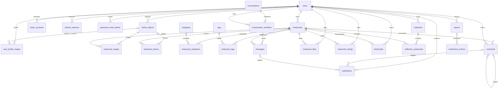

# Database design

Migration 000002 เพิ่ม `oauth_states` สำหรับ single-use Google state/nonce/PKCE อายุ 10 นาที รวมเป็น 26 ตาราง application

MySQL 8.4 LTS (MySQL 8 family), InnoDB, utf8mb4 สำหรับภาษาไทย, UTC `DATETIME(6)` ทุก connection ต้องใช้ UTC UUID สร้างโดย application เก็บเป็น `CHAR(36)` ascii_bin; schema ไม่ได้ตรวจรูปแบบ UUID ดังนั้น API ต้อง validate IDs

## ตาราง

| กลุ่ม | ตาราง | หน้าที่ |
| --- | --- | --- |
| บัญชี | users, user_profile_images | โปรไฟล์ บทบาท สถานะ preferences และรูป |
| Authentication | oauth_accounts, refresh_sessions, password_reset_tokens | OAuth identity, token rotation/revocation, reset password |
| รูป | media_objects | เจ้าของ bucket/object key, MIME, ขนาด, dimensions, lifecycle |
| ร้าน | restaurants, restaurant_images, restaurant_menus | ร้านของผู้ใช้ รูปเรียงลำดับ/ปก เมนู ราคา |
| หมวดหมู่ | categories, tags, restaurant_categories, restaurant_tags | many-to-many classification |
| Social | comments, restaurant_likes, restaurant_ratings | replies, likes, ratings 1–5 |
| รายการบันทึก | collections, collection_restaurants, bookmarks | คอลเลกชันและ bookmark |
| Chat | conversations, conversation_members, messages | 1:1 chat, read cursor, idempotency |
| Moderation | reports, moderation_actions | report target ที่มี FK และ audit trail |
| Notifications | notifications | comment/reply/message และเวลาอ่าน |

Schema เตรียม P0–P2 ตามสเปก; backend Phase 1 implement แล้ว ดูขอบเขตและข้อจำกัดใน README ส่วน social/chat/admin ยังมีเฉพาะ schema ร้านหนึ่งรายการเป็นของผู้ใช้หนึ่งคน ไม่ใช่ global restaurant catalog การ bookmark ร้านของคนอื่นใช้ `bookmarks`



## ข้อจำกัดและความรับผิดชอบของ API

- Unique email/username ใช้ case/accent-insensitive collation; normalize email ใน API ไม่เชื่อม OAuth ด้วย email ที่ไม่ได้ verify และไม่บังคับ password สำหรับ OAuth-only account
- Refresh/reset tokens เก็บ SHA-256 digest 32 bytes เท่านั้น ส่วน password ใช้ Argon2id/bcrypt encoded hash หมุน refresh token ใน transaction ล็อกแถวเดิม เก็บ `family_id` เดิม และ revoke ทั้ง family เมื่อพบ reuse
- FK ใช้ RESTRICT โดยปริยายเพื่อไม่ให้ลบ audit/chat/media แบบเงียบ ๆ ใช้ soft delete สำหรับผู้ใช้ ร้าน คอมเมนต์ คอลเลกชัน และข้อความ การ purge ต้องจัดลำดับเองรวมถึง read cursor และ refresh replacement references
- รูปปกได้มากสุดหนึ่งรูปต่อร้านผ่าน generated nullable `cover_slot` + unique index เปลี่ยนปกใน transaction โดย clear ปกเดิมก่อน ร้านที่ไม่มีรูปปกใช้รูปแรกหรือ placeholder ใน UI
- `parent_id` ของคอมเมนต์ต้องอยู่ร้านเดียวกัน ไม่อนุญาตอ้างตัวเอง API ต้องกำหนด parent ตอนสร้างเท่านั้นเพื่อป้องกัน cycle ภายหลัง
- Like/rating/bookmark ต่อ user+restaurant ซ้ำไม่ได้ ราคาต้องไม่ติดลบ พิกัดต้องครบคู่และอยู่ในช่วง
- Chat ใช้ UUID คู่เรียงตาม ascii `user_low_id < user_high_id` และ unique pair ป้องกันห้อง 1:1 ซ้ำ API ต้องสร้างสมาชิกสองคนที่ตรงคู่นี้ใน transaction และห้ามเพิ่มคนที่สาม DB ตรวจว่าส่งโดยสมาชิก และ read cursor อ้างข้อความในห้องเดียวกัน แต่ไม่ได้ enforce จำนวนสมาชิก/คู่กับ member rows
- Message retry ใช้ unique `(conversation_id, sender_id, client_message_id)` หากส่งซ้ำให้คืน message เดิม API ต้องอัปเดต read cursor ให้เดินหน้าเท่านั้น
- รูป/ร้าน/เมนู/คอลเลกชันต้องตรวจ ownership ใน API ก่อนเขียน FK ตรวจว่ามีแถวจริง แต่ไม่แทน authorization
- Default ร้านและคอลเลกชันเป็น PRIVATE ทุก query สาธารณะต้องกรอง `visibility='PUBLIC' AND deleted_at IS NULL` รวมสถานะเจ้าของตาม policy ห้ามส่ง private restaurant ผ่าน collection/chat/notification หรือ presigned image URL โดยไม่ตรวจสิทธิ์ใหม่
- Reports และ notifications ใช้ explicit nullable FKs พร้อม CHECK ตามชนิด แทน polymorphic target ID ที่ DB ตรวจไม่ได้ ตรวจบทบาท ADMIN ก่อนเขียน moderation actions
- ไม่เก็บ social counters ซ้ำใน MVP ให้ aggregate ด้วย index หรือ batch query เมื่อต้องเพิ่ม cache ค่อยทำ migration

## Query และ pagination

Feed ใช้ `(created_at,id)` เป็น cursor เรียง DESC ทั้งคู่ พร้อม filter visibility และ deleted_at มี composite indexes สำหรับ public feed, owner list, visit status, comments, chat history และ notifications

```sql
SELECT id, name, address, price_min, price_max
FROM restaurants
WHERE visibility = 'PUBLIC' AND deleted_at IS NULL
  AND (created_at < ? OR (created_at = ? AND id < ?))
ORDER BY created_at DESC, id DESC
LIMIT ?;
```

ค้นหาชื่อ/ที่อยู่ภาษาไทยใน MVP ใช้ parameterized LIKE พร้อม escape `%`/`_` ตามความหมายที่ต้องการ และจำกัดผลลัพธ์ (leading wildcard scan ไม่ scale) หมวดหมู่ใช้ join ผ่าน junction indexes ไม่ใส่ FULLTEXT โดยสมมติว่าจะตัดคำภาษาไทยได้ หากข้อมูลมากให้เพิ่ม search engine/tokenizer ที่รองรับภาษาไทยและวัดผลจริง
